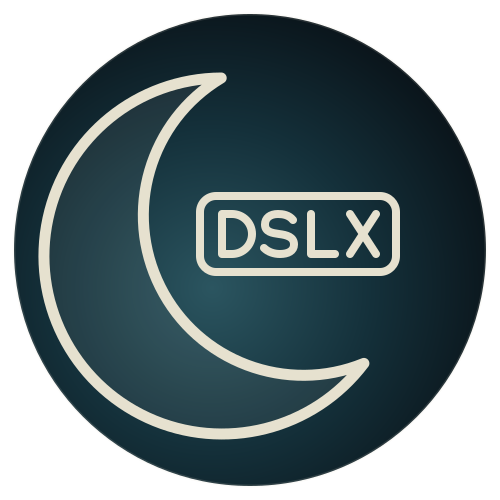

<p align="center">
  
</p>

<h1 align="center">DSLX</h1>

<p align="center">
  <em>Davi System: Lua XML</em>: a JSX-like syntax for Lua.<br/>
  <a href="https://pessoa736.github.io/DLuaXML/">Website &amp; docs</a> ·
  <a href="https://pessoa736.github.io/DLuaXML/playground.html">Playground</a> ·
  <a href="README.pt-BR.md">Português</a>
</p>

<p align="center">
  <a href="https://luarocks.org/modules/pessoa736/daviluaxml"></a>
</p>

> [!WARNING]
> Experimental project. APIs may change without notice.

In a `.dslx` file, any Lua function can be called as an XML tag. Each tag becomes a function call that receives one table, `{ name, props, childrens }`, and the whole file is compiled to plain Lua (parsed with [LPeg](https://www.inf.puc-rio.br/~roberto/lpeg/)) before it runs.

## Install

```bash
luarocks install daviluaxml
```

Requires Lua 5.5.

## Example

```lua
-- hello.dslx
local function greet(el)
    return "Hello, " .. el.props.name .. "!"
end

return <greet name="world"/>
```

```lua
-- main.lua
package.path = package.path .. ";./?.dslx"
require("dslx")                -- adds a searcher for .dslx files
print((require("hello")))      --> Hello, world!
```

Syntax, the `parser` / `runtime` / `compile` / `import` modules and more examples are in the **[documentation](https://pessoa736.github.io/DLuaXML/overview.html)**.

## License

MIT. Feel free to fork and play with it, keeping the credits :)
