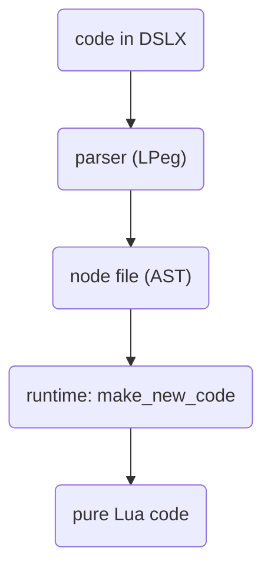

# DSLX - Davi System Lua-XML

<div style="display: flex; justify-content: center; justify-self: left;">
    
    <p>A JSX-like interpreter for Lua.</p>
    <a href="https://luarocks.org/modules/pessoa736/daviluaxml">
        
    </a>
    <a href="https://github.com/pessoa736/DLuaXML/releases/tag/2.2-1">
        
    </a>
</div>

[English](README.md) | [Português](README.pt-BR.md)

> [!WARNING]
> Experimental project. APIs may change without notice.

## table of contents

- [DSLX - Davi System Lua-XML](#dslx---davi-system-lua-xml)
  - [table of contents](#table-of-contents)
  - [what is DSLX about?](#what-is-dslx-about)
  - [installation](#installation)
  - [how does it work?](#how-does-it-work)
    - [syntax](#syntax)
    - [importing .dslx through require](#importing-dslx-through-require)
  - [API](#api)
    - [parser](#parser)
    - [extending the parser](#extending-the-parser)
    - [runtime](#runtime)
    - [compile](#compile)
    - [import](#import)
    - [is\_element](#is_element)
  - [what DSLX is not](#what-dslx-is-not)
  - [license](#license)

## what is DSLX about?

DSLX (or Davi System: Lua XML) is a module that gives Lua the ability to interpret .dslx files, which allow reading Lua code and turning XML into pure Lua in the same file and then executing it, much like JSX.

As of version 2.0 the module was renamed to `dslx` and rewritten on top of [LPeg](http://www.inf.puc-rio.br/~roberto/lpeg/): the parser turns the code into an AST (a `file` root node with the child nodes) and the runtime generates (and executes) pure Lua code from it.



## installation

```bash
luarocks install daviluaxml
```

Requirements: Lua 5.5, [inspect](https://github.com/kikito/inspect.lua), [LPeg](http://www.inf.puc-rio.br/~roberto/lpeg/) (installed automatically as a dependency).

## how does it work?

In a .dslx file, any function defined in the Lua environment can be called in XML format. The tag becomes a function call that receives a single table with the tag name, the props and the childrens:


```lua
--- code in dslx
local function soma(element)
    local soma = 0 
    for _, valor in ipairs(element.childrens) do
        soma = soma + valor
    end

    return soma + element.props.t
end

local pt = function(element) print(table.unpack(element.childrens)) end


<pt>
    <soma t={9}>
        {1}{2}{3}
    </soma>
</pt>

print("final do test")
```

```lua
--- becomes lua code
local function soma(element)
    local soma = 0 
    for _, valor in ipairs(element.childrens) do
        soma = soma + valor
    end

    return soma + element.props.t
end

local pt = function(element) print(table.unpack(element.childrens)) end


pt{name="pt", props={}, childrens={soma{name="soma", props={t=9}, childrens={1, 2, 3}}}}

print("final do test")
```

### syntax

Props and childrens can be strings, Lua expressions, booleans or nested elements (the content of a `.dslx` file):

```dslx
local function card(el)
    -- props
    el.props.titulo   -- "olá"    (string)
    el.props.largura  -- 10       (Lua expression)
    el.props.destaque -- true     (boolean, just the prop name)

    -- childrens
    el.childrens[1]    -- "texto " (literal text)
    el.childrens[2]    -- 42       (Lua expression)
    el.childrens[3]    -- table    (nested element)
end

-- full tag
local c1 = <card titulo="olá" largura={10} destaque>
texto {40 + 2} 
    <card/>
</card>

-- self-closing tag
local c2 = <card titulo="tchau"/>
```

A nested element becomes a call to the component inside the childrens table: the value it returns is what appears in `el.childrens`. If the component returns `nil`, the child simply doesn't exist. And since in Lua values are evaluated before the table constructor, the nested element runs before its parent.

### importing .dslx through require

When your project imports the DSLX module it loads the DSLX loader, overriding require in the environment where it was imported, allowing you to import .dslx the same way as .lua:

```lua
package.path = package.path .. ";./dslx/test/?.dslx"
local dslx = require("dslx") -- installs the searcher automatically
local ok = require("1")     -- loads and runs 1.dslx
print("import ok:", ok)     -- true
```

## API

### parser

```lua
local file = parser(code)
```

Turns the code into an AST: a root node `{node_type = "file", children = {...}}` with the child nodes. Each node has a `node_type`: `file`, `lua`, `script`, `full_element`, `element_self_close` or `element_prop`. On failure, it returns an empty table (whose `tostring` is `"nil (Falha no Parser)"`); on success, the node can be printed directly with `print(file)`.

### extending the parser

The LPeg patterns live in a registry (`parser.patterns`) and the grammar can be extended without touching the source code:

- `parser:SetPattern(name, pattern)` — registers (or replaces) a pattern
- `parser:GetPattern(name)` — returns a registered pattern (error if it doesn't exist)
- `parser:SetParserPrincipal(name)` — sets which pattern the `match` uses
- `parser:match(code)` — runs the main parser over the code
- `parser.lpeg` — the LPeg module, for building new patterns

Example: a strict parser, which fails if there's leftover code after the last node:

```lua
local parser = require("dslx.parser")

parser:SetPattern("File_parser_strict",
    parser:GetPattern("File_parser") * -parser.lpeg.P(1))

parser:SetParserPrincipal("File_parser_strict")

local file = parser("<div/>") -- now uses the new pattern
```

> [!NOTE]
> Pattern composition is static: each pattern is built with `GetPattern` at the moment it's defined. Changing a base pattern (like `element_name`) after load doesn't affect the patterns that were already composed with it — for that you also need to redefine the chain of dependents. The simplest way to extend is to create a new pattern on top of the existing ones, as in the example above.

### runtime

- `runtime:addHandler(name, func)` — registers a custom handler per `node_type` (`name` can be a string or a table of names)
- `runtime:expr(node, handlers)` — returns the Lua code of a node
- `runtime:make_new_code(nodes, handlers)` — returns the complete Lua code
- `runtime:runtime(file, handlers)` — compiles and executes the code (accepts the `file` node returned by the parser or a list of nodes)

### compile

```lua
compile({
    input = "arquivo.dslx",       -- input .dslx file (or code, with asfile = false)
    asfile = true,                -- reads input as a file
    tofile = true,                -- writes output to a file (false: returns the code)
    run = false,                  -- runs the result
    output_name = nil,            -- output file name (default: input name)
    output_ext = ".lua",          -- output extension
    output_dir = ".",            -- output directory
    relative_actual_file = false, -- resolves relative paths against the calling file
})
```

With `tofile = false` and `run = false` `compile` returns the generated code; with `run = true` it executes the result.

### import

- `import.install()` / `import.uninstall()` — adds/removes the .dslx searcher from `require()`
- `import.loadfile(filename, opts)` — loads a .dslx directly
- `import.reload(name)` — reloads an already imported module
- `import.clear()` — clears the loaded .dslx modules and the cache
- `import.path` — the `package.path` used by the searcher
- `import.use_cache` — compilation cache (default: true)

### is_element

```lua
local ok, err, nparams = is_element(minha_funcao)
```

Global installed by `require("dslx")`. Validates whether a function works as a DSLX element: it must be a function that takes exactly 1 argument (the element table).

Returns `true` if it works; otherwise `false`, the error message and the number of parameters of the function.

## what DSLX is not

- **it's not html**, html is a web language for creating pages, DSLX is a Lua+XML. and XML is a rigid structuring language for systems.

- **it's not a Lua replacement**, DSLX is meant to work together with Lua


## license

This module is MIT. Feel free to play around and do whatever you want with your fork of this project, keeping the credits :)
