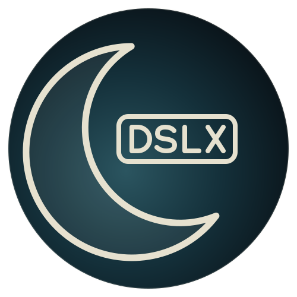

<p align="center">
  
</p>

<h1 align="center">DSLX</h1>

<p align="center">
  <em>Davi System: Lua XML</em>: uma sintaxe estilo JSX para Lua.<br/>
  <a href="https://pessoa736.github.io/DLuaXML/">Site e documentação</a> ·
  <a href="https://pessoa736.github.io/DLuaXML/playground.html">Playground</a> ·
  <a href="README.md">English</a>
</p>

<p align="center">
  <a href="https://luarocks.org/modules/pessoa736/daviluaxml"></a>
</p>

> [!WARNING]
> Projeto experimental. APIs podem mudar sem aviso.

Num arquivo `.dslx`, qualquer função Lua pode ser chamada como uma tag XML. Cada tag vira uma chamada de função que recebe uma tabela, `{ name, props, childrens }`, e o arquivo inteiro é compilado para Lua puro (com parser em [LPeg](https://www.inf.puc-rio.br/~roberto/lpeg/)) antes de rodar.

## Instalação

```bash
luarocks install daviluaxml
```

Requer Lua 5.5.

## Exemplo

```lua
-- hello.dslx
local function greet(el)
    return "Olá, " .. el.props.nome .. "!"
end

return <greet nome="mundo"/>
```

```lua
-- main.lua
package.path = package.path .. ";./?.dslx"
require("dslx")                -- adiciona um searcher para arquivos .dslx
print((require("hello")))      --> Olá, mundo!
```

Sintaxe, os módulos `parser` / `runtime` / `compile` / `import` e mais exemplos estão na **[documentação](https://pessoa736.github.io/DLuaXML/overview.html)** (em inglês).

## Licença

MIT. Fique à vontade para fazer fork e brincar, mantendo os créditos :)
